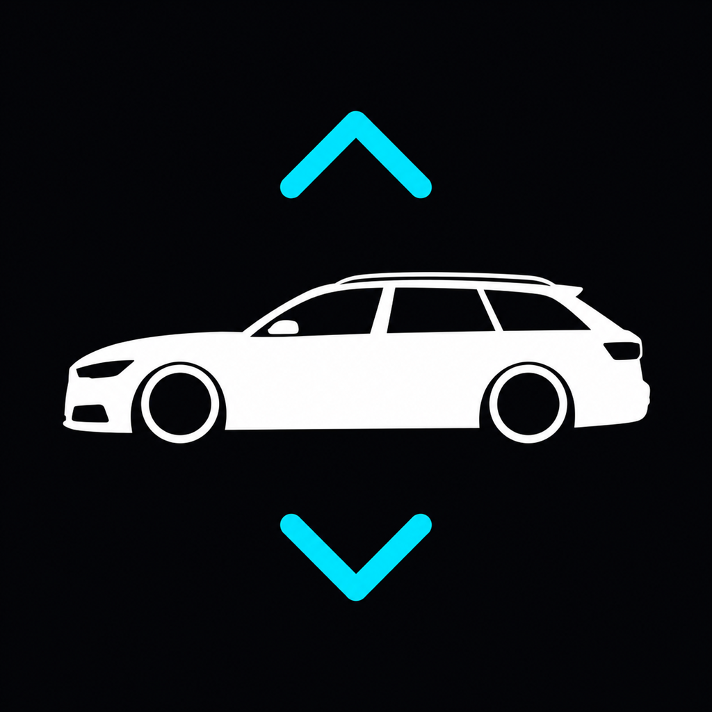

# OBDLevel



An iOS app that talks to an **OBDeleven** adapter over BLE and speaks **UDS (ISO 14229)** directly —
no OBDeleven account, no cloud, no ODX download.

Reads air-suspension heights, runs and stops routines (vent front axle, vent rear axle,
level control off/on), and includes scanners so you can find your own car's DIDs and routine ids.

Everything documented below was recovered from the Android client (`com.voltasit.obdeleven`)
with jadx. Nothing here is guessed.

---

## Contents

1. [What works and what can't](#1-what-works-and-what-cant)
2. [Hardware](#2-hardware)
3. [Wire protocol](#3-wire-protocol)
4. [Command reference](#4-command-reference)
5. [UDS services used](#5-uds-services-used)
6. [Sequence: opening an ECU](#6-sequence-opening-an-ecu)
7. [Reading heights](#7-reading-heights)
8. [Running routines](#8-running-routines)
9. [Security access](#9-security-access)
10. [Where the IDs come from](#10-where-the-ids-come-from)
11. [Finding your car's IDs](#11-finding-your-cars-ids)
12. [Building the app](#12-building-the-app)
13. [Using the app](#13-using-the-app)
14. [Project layout](#14-project-layout)
15. [Reverse-engineering notes](#15-reverse-engineering-notes)
16. [Troubleshooting](#16-troubleshooting)
17. [Safety](#17-safety)
18. [Limits and known gaps](#18-limits-and-known-gaps)

---

## 1. What works and what can't

| | Status |
|---|---|
| BLE link to 2nd-gen adapter | works |
| Raw UDS over ISO-TP (CAN) | works |
| Read DIDs (live values, heights) | works |
| Start / stop / poll routines (`31 01`, `31 02`, `31 03`) | works |
| Session control (`10 03`), tester present (`3E 00`) | works |
| Adapter generation read (`08` → 1/2/3, Pro 3) | works |
| Demo mode (simulated heights, no BLE) | works |
| Battery voltage channel | works — DID found by the automatic search |
| Automatic DID discovery (`22` probing + scaling guesses) | works, ranges configurable |
| Automatic RID discovery (`31 03` only, never starts anything) | works |
| Quick raise / lower buttons | works — whole-car basic settings, `31 01 03DD` / `31 01 03E0` |
| Identify a routine by measuring (`Mät & mappa`) | works — runs 8 s, measures the corners, assigns the role |
| Security access (`27 01`/`27 02`) | implemented, key algorithm must be supplied |
| K-line / KWP2000 transport selection | selectable (`20 05`), KWP framing not implemented |
| 1st-gen adapter on iOS | **impossible** (Classic SPP, needs MFi) |
| Named basic-setting list ("Vent front axle" as a label) | **not available** — the names live in the ODX pack, not the app |

---

## 2. Hardware

| | 1st gen | 2nd gen (white) |
|---|---|---|
| Radio | Bluetooth Classic SPP | BLE |
| Service UUID | `00001101-0000-1000-8000-00805F9B34FB` | `FFE0` (data), `FFE3` (control / firmware) |
| Characteristic | — | `FFE1` (write + notify), `FFE4` (control) |
| iOS | **no** | yes |

In the APK these are two separate classes: `ClassicBluetoothDevice` (RFCOMM socket) and
`LeBluetoothDevice` (GATT). The old dongle is a serial-port-profile device — Apple requires MFi
certification for SPP, so CoreBluetooth will never see it. Use the 2nd-gen adapter.

### Generations

The adapter reports its own generation: command `08` returns `08 00 <gen>`
(`ReadDeviceGenerationCommand` in the APK).

| Gen | Hardware | Generation byte |
|---|---|---|
| 1 | classic SPP | 1 |
| 2 | BLE | 2 |
| 3 | **Pro 3**, BLE | 3 |

**Pro 3 works with this app.** It answers generation `3` on the same command channel, and the
frame set (`08`, `20`, `21`, `22`) is unchanged. The Link tab shows the generation as soon as the
characteristic subscribes, so you can verify the link before touching an ECU.

"Pro" is the subscription tier that unlocks basic settings *inside the official app*. It has no
bearing here — the ECU does not know or care which plan you bought.

**Characteristic details**

- Write to `FFE1`, notifications from `FFE1`. Enable notifications right after discovery.
- Maximum **20 bytes per GATT write**. The Android client buffers exactly 20 bytes
  (`byte[20]`) and flushes when full.
- Writes use *write with response*; the client waits for `didWriteValueFor` before the next chunk.
- `FFE4` is only used for firmware update, info packets and target configuration. Normal
  diagnostics never touch it.

---

## 3. Wire protocol

Two layers. The inner layer is the command (`21 …`, `22 …`, `20 …`, `08 …`). The outer layer is
what actually goes over BLE, and it is **not** the command bytes — they are obfuscated, checked
and escaped first. Writing the raw command bytes to `FFE1` does nothing at all, which is exactly
what happens if you skip this section.

### Outer layer: framing, obfuscation, CRC

Recovered from `com.voltasit.obdeleven.utils.bluetooth.n` (`DeviceBase`), methods `a()`, `l()`,
`j()` and `k()`.

**Encode a command** (hex string → bytes `P`):

1. Pick a random key with bit 7 set: `key = random(0…127) | 0x80`.
2. Emit `key` itself, then every payload byte XORed with `key`. After each byte, rotate the key
   right by one bit: `key = ((key >> 1) | (key << 7)) & 0xFF`.
3. Compute CRC-16/XMODEM over those bytes — init `0x0000`, poly `0x1021`, MSB first — and append
   it **low byte then high byte**.
4. Wrap in `0x0F … 0x04`, escaping `0x04`, `0x05` and `0x0F` with a leading `0x05`:

```
wire = 0F <escaped body> 04
```

**Decode a response** (mirror image):

1. Split the stream on `0x0F` (start) and `0x04` (end); `0x05` escapes the next byte.
2. Drop the last two bytes (CRC — the client never verifies it).
3. If the first byte has bit 7 set, it is the key: XOR the rest with it, rotating right one bit
   per byte, and drop the key byte.

What comes out is the inner command response, e.g. `21 00 02 00 50 03`.

`DeviceBase.a()` skips all of this for commands where `c()` is true (raw mode, used by firmware
traffic). Every diagnostic command in this app is `c() == false`, so every write is encoded and
every read is decoded.

### Chunking

`LeBluetoothDevice.b(byte)` buffers exactly **20 bytes** and flushes when the buffer is full;
the remainder is flushed at the end. So a logical frame is split at arbitrary 20-byte boundaries
and the adapter reassembles it from the `0x0F`/`0x04` markers. Writes use write-with-response and
the next chunk is only sent after `didWriteValueFor`.

### Inner layer: commands

```
request   21 <lenLo> <lenHi> <payload...>
response  21 <err>   <lenLo> <lenHi> <data...>
```

- `err == 0` means success. Anything else aborts the command (`CommandException(err)`).
- `len` is little-endian and counts **payload bytes only**, not header.
- `payload` is the **raw UDS request** — e.g. `22 F1 87`, `31 01 03 21`, `10 03`.
- `data` is the raw UDS response, e.g. `62 F1 87 00 1A`.

### IOCTL

```
request   22 <sub> <data...>
response  22 <err> <data...>
```

| sub | meaning | payload |
|---|---|---|
| `00` | CAN receive filter (rx id) | 4 bytes, little-endian CAN id |
| `01` | CAN transmit id (tx id) | 4 bytes, little-endian CAN id |

Confirmed in `SetCanFilterUC` (`"00" + id`) and `SetCanTxIdUC` (`"01" + id`). Response has **no
length field** — the whole remainder of the frame after `err` is the payload. Send these one at a
time and let each notification complete.

### Protocol select

```
request   20 <proto>
response  20 <err>
```

| proto | transport |
|---|---|
| `00` | null / disconnect |
| `01` | CAN (raw) |
| `02` | ISO-TP (ISO 15765-2) |
| `03` | TP20 |
| `04` | TP16 |
| `05` | K-line |
| `06` | ISO-TP OBD2 |

For UDS on CAN you want `02`.

### Generation

```
request   08
response  08 00 <gen>
```

`ReadDeviceGenerationCommand` checks `bArr[0] == 8 && bArr[1] == 0` and returns `bArr[2]`.

### Gen 2 / Pro 3 differences

The Android client has two device classes: `Device` (first gen, Classic SPP) and `DeviceGen2Or3`
(`DeviceGen2Or3.java`). For the BLE Pro units only the *device-side* commands differ — auth,
version, voltage — while the outer frame is byte-for-byte the same `0F … 04` with the same XOR
key rotation, CRC-16/0x1021 and 0x05 escaping. Verified by decompiling
`com.voltasit.obdeleven.utils.bluetooth.o` (`DeviceGen2Or3.k(byte[], boolean)`), which repeats
the gen-1 writer unchanged.

Gen-2/3 device commands. The opcode is the first byte of the request, the reply starts with the
same opcode followed by an error byte:

| Opcode | Meaning | Reply | Source |
|---|---|---|---|
| `08` | read generation | `08 00 <gen>` | `ReadDeviceGenerationCommand` |
| `10` | read firmware version | `10 00 <4 bytes, LE` short `>` | `p047d8.g` (ReadVersionCommand) |
| `11` | read serial number | `11 00 <11 ASCII bytes>` | `p047d8.f` (ReadSerialNumberCommand) |
| `12` | read CPU id | `12 00 <12 bytes>` | `p047d8.b` (ReadCpuIdCommand) |
| `14` | write password | `14 …` | `p047d8.l` (WritePasswordCommand) |
| `15` | read adapter voltage | `15 00 <V> <centi>` | `p047d8.h` (ReadVoltageCommand) |
| `16` | write voltage | `16 …` | `p047d8.m` |
| `1C` | read full version | `1C 00 <ASCII>` | `p047d8.d` (ReadFullVersionCommand) |

The gen-1 class (`Device`) uses the same commands shifted by one, because `16`/`17` are its
voltage pair: gen 1 voltage is `16`, password is `15`.

The standard connect chain for a Pro 3 (`DeviceGen2Or3.p(boolean)`) is `1C` (or `10`), then `11`,
then `12` — it reads full version, serial number and CPU id and **never sends a password**. So an
activated unit does not require the auth write just to answer. `IDevice.h(String)` builds
`14` + `Converter.c(password)`, and `Converter.c` is only `hex(UTF-8 bytes)`; the plaintext itself
comes from account data on the server and is not present in the APK, so this client does not
attempt it.

Two consequences for a third-party client:

* `08`, `10`, `11`, `12`, `15` and `1C` need **no** car and no CAN setup. If they are all silent,
  the problem is the BLE link (write type, notification state, wrong characteristic), not the CAN
  ids.
* `Testa anslutning` starts with `08`, `10` and `12` for exactly that reason: they separate "the
  adapter does not answer at all" from "the car does not answer".

### Example: trivial exchange

Inner commands:

```
> 20 02
< 20 00
> 22 00 7E 07 00 00
< 22 00
> 22 01 14 07 00 00
< 22 00
> 21 02 00 10 03
< 21 00                                         ← ACK: request is on the bus
< 21 00 06 00 50 03 00 32 01 F4                ← the module's answer
```

Every UDS request gets **two** frames back: a bare `21 00` ACK, then the response. They can arrive
in the same notification or in separate ones, split at arbitrary boundaries. Treating the bare
`21 00` as an empty answer abandons the wait, and the real reply then shows up as unsolicited —
which looks exactly like "the module is silent" even though it answered.

The id bytes are **little-endian**, exactly what `Converter.g()` builds in the Android client:
`0x77E → 7E 07 00 00`, `0x714 → 14 07 00 00`. A 29-bit id sets bit 31 first
(`id | 0x80000000` → `7E 07 00 80`). Writing them big-endian (`00 00 07 7E`) is accepted by the
ioctl and looks like success, but the adapter then filters on a bus that does not exist and answers
every UDS request with `21 FE` (`RESULT_NOT_CONNECTED`) — which is exactly how a wrong-endianness
bug presents itself.

What crosses the BLE link for the last one — one key byte, XORed payload, CRC, escaped:

```
> 0F C3 9B E8 5A 62 15 F4 3B 6D ... 04
< 0F 9A 8F FA 1C 2D ... 04
```

`50 03` = positive response to `10 03`, extended session active.

---

## 4. Command reference

| Frame | Direction | Meaning |
|---|---|---|
| `20 <proto>` | host → adapter | select transport |
| `20 <err>` | adapter → host | protocol set result |
| `21 <lo> <hi> <uds>` | host → adapter | UDS request |
| `21 00` | adapter → host | ACK only: request reached the bus, the answer follows in its own frame |
| `21 <err>` | adapter → host | negative result, no length field follows |
| `21 <err> <lo> <hi> <data>` | adapter → host | UDS response |
| `22 00 <id4>` | host → adapter | set CAN rx filter (id little-endian) |
| `22 01 <id4>` | host → adapter | set CAN tx id (id little-endian) |
| `22 <err> <echo…>` | adapter → host | ioctl result |

Timing rules taken from the client:

- Command timeout **5000 ms** (`Command` default), session keep-alive every **2000 ms** while
  connected, **1000 ms** on KWP.
- The client serialises commands through a single queue — never fire two requests concurrently.
  This app does the same with a continuation gate.
- 15 ms settle time between commands is enough on real hardware.

---

## 5. UDS services used

| Purpose | Request | Positive response | Notes |
|---|---|---|---|
| Diagnostic session | `10 03` | `50 03` | 03 = extended |
| Tester present | `3E 00` | `7E 00` | keep-alive |
| Read data by identifier | `22 <hi> <lo>` | `62 <hi> <lo> <data…>` | live values, heights |
| Security access — seed | `27 01` | `67 01 <seed>` | level 01 |
| Security access — key | `27 02 <key>` | `67 02` | key from seed |
| Routine control — start | `31 01 <hi> <lo> [params]` | `71 01 <hi> <lo> <status>` | |
| Routine control — stop | `31 02 <hi> <lo>` | `71 02 …` | |
| Routine control — results | `31 03 <hi> <lo>` | `71 03 <hi> <lo> <status>` | poll this |

### Negative responses

`7F <service> <code>` — the app decodes these:

| Code | Name | Handling |
|---|---|---|
| `0x10` | generalReject | surface |
| `0x11` | serviceNotSupported | surface |
| `0x12` | subFunctionNotSupported | surface |
| `0x13` | incorrectMessageLength / bad length | surface |
| `0x21` | busyRepeatRequest | **retry, up to 3×** |
| `0x22` | conditionsNotCorrect | surface (usually ignition/hood/engine state) |
| `0x23` | routineNotComplete | **retry, up to 3×**, and treated as "still running" while polling |
| `0x24` | requestSequenceError | surface |
| `0x31` | requestOutOfRange | wrong DID/RID |
| `0x33` | securityAccessDenied | run security access first |
| `0x35` | invalidKey | wrong key algorithm |
| `0x36` | exceededAttempts | **stop — ECU is locking out.** Cycle ignition, wait |
| `0x37` | requiredTimeDelayNotExpired | wait, then retry |
| `0x78` | responsePending | keep waiting |

`0x36` is the one that bites people. Three bad keys in a row and the ECU refuses for the rest
of the ignition cycle, sometimes longer.

---

## 6. Sequence: opening an ECU

```
1. set protocol       20 02                       ISO-TP
2. set rx filter      22 00  <rxId LE, 4 bytes>   response id of the ECU (77E → 7E 07 00 00)
3. set tx id          22 01  <txId LE, 4 bytes>   request id of the ECU (714 → 14 07 00 00)
4. extended session   21-len 10 03               → 50 03
5. tester present     3E 00 (every 2 s)          → 7E 00
```

The app does steps 1–4 in `connectECU()`, and sends `3E 00` once as a sanity check. Add a
repeating keep-alive if you plan to sit on a session for minutes; most ECUs drop back to default
session after ~5 s without traffic.

TX/RX ids are in **Config**. Typical 11-bit UDS pairs (engine/transmission style) use
`0x7E0/0x7E8`; the air-suspension ECU on most VAG cars is somewhere in `0x7xx`. If you don't know
them, read them out of the ODX pack or sniff them with a CAN logger while OBDeleven connects.

---

## 7. Reading heights

Heights are **not basic settings** — they are live values, read with `22 <did>`.

```
> 21 03 00 22 2B 0F
< 21 00 05 00 62 2B 0F 01 9A
                    └──┬──┘ └┬─┘
                     header  data (2 bytes)
```

Decoding is per channel, configured in **Config → Height channels**:

| Field | Meaning |
|---|---|
| `DID` | identifier, hex |
| `len` | payload bytes to consume (1–4) |
| `signed` | two's complement |
| `scale` | multiplier |
| `offset` | added after scaling |

Most air-suspension ECUs report tenths of a millimetre, so `len 2`, `signed on`, `scale 0.1`
gives millimetres directly. Confirm by watching the number change when you push down on a corner.

Typical set to hunt for (four corners + computed level):

- front left, front right, rear left, rear right sensor heights
- vehicle level / deviation from nominal
- compressor status, system pressure, accumulator pressure

If all four read `0.0` or a constant, it's a wiring or sensor fault — recalibration will not fix it.

---

## 8. Running routines

Basic settings are **routine control**. That is all they are — the app just gives them names from
the ODX file.

```
start    31 01 <ridHi> <ridLo> [params]
poll     31 03 <ridHi> <ridLo>          every ~400 ms
stop     31 02 <ridHi> <ridLo>
```

Result payload after `71 03 <ridHi> <ridLo>`:

| Status | Meaning |
|---|---|
| `00` | not active / idle |
| `01` | running |
| `02` | finished, success |
| `03` | finished, error |

`runRoutine()` in `ECUConnection` starts, polls until status is `00/02/03`, and gives up after
75 s for a level move (25 s for a switch). While polling, NRC `0x23` (`routineNotComplete`) is
treated as "still running", not an error. The status byte is the **fifth** byte of
`71 03 <ridHi> <ridLo> <status> …`; the fourth is the low byte of the RID.

Some routines take parameters. In the Android app, `GetBasicSettingRequestParamUC` builds a
parameter block for those — e.g. calibration routines want the measured heights typed in. Wire
those into `RoutineAction.parameters` (raw bytes) when you find one that needs them.

VW basic settings use a fixed three-byte option record from the ODX table
`TAB_RoutiContrBasicSetti`: `04 00 00` (`DOP_TEXTTABLEVWCommoRoutiEntryOptioBasicSetti` codes it as
*Default Parameter Value*). So a start looks like:

```
> 31 01 03 DD 04 00 00
< 71 01 03 DD
> 31 03 03 DD            every ~400 ms
< 71 03 03 DD 01         running
< 71 03 03 DD 02         finished
```

The app sends that record for every known routine in module 34.

An ECU may answer `7F 31 78` first. That is ISO 14229 *responsePending*: the request is accepted
and the `71 …` frame follows. The transport keeps the exchange open and waits for it; it must not
resend `31 01`, because a second start can restart the routine or trip `requestSequenceError`.

Routines that need the **hood open** are gated by the ECU, not the app: the original client reads
a flag first (`isPopTheHoodRequired`) and disables the button. If yours returns NRC `0x22`,
that is why.

---

## 9. Security access

```
> 27 01
< 67 01 <seed…>
> 27 02 <key…>
< 67 02
```

Implemented in `ECUConnection.securityAccess(level:keyAlgorithm:)`. The seed→key algorithm is
**per manufacturer and lives server-side** in the OBDeleven ecosystem — it is not in the APK in
usable form. Supply your own closure:

```swift
try await ecu.securityAccess(level: 0x01) { seed in
    // your algorithm
    return key
}
```

Without it you get `0x33 securityAccessDenied` on anything that writes.

**Do not brute force keys.** `0x36 exceededAttempts` locks the ECU and increments an attempt
counter that some modules persist.

---

## 10. Where the IDs come from

They are not in the APK. The full chain, verified end to end:

1. `ServerApiImpl.getOdxListByName` / `getOdxListByPlatform` query the Parse class **`ODX`**
   (`where={"values":"EV_AirSuspe"}`), which returns `fileName`, `platform` and a `file` URL on
   `storage.obdeleven.com`.
2. The download is a **ZIP with AES-256** (`compress_type 99`, general-purpose flag bit 0 set),
   one entry such as `EV_AirSuspe_003024.odx` (~731 kB XML).
3. The ZIP password is not shipped either: `NetworkOdxFactory` calls the cloud function
   **`functions/odxV2`** (no params), gets back 32 bytes of hex ciphertext, and runs
   `AES/CBC/PKCS5` over it with hex key `c(6)` and hex IV `c(7)` from
   `Parse.invokeNativeFunction(index)` — a **native symbol**, so both constants live in
   `lib*.so`, not in the dex.
4. `OdxRepositoryImpl` / `OdxWorkerRepositoryImpl` then parse the decrypted XML with SimpleXML into
   `DIAG-LAYER`, `BASIC-STRUCTURE`, `PARAMS`, `REQUESTS`, `POS-RESPONSES`.
5. `GetBasicSettingsUC` builds the list the UI shows, and display names are `MAS…` text ids
   resolved against a translation table that is not bundled either.

The APK has **no strings.xml, no bundled resources, no hardcoded DID or RID table**, and the
emulator build has an empty `lib/x86_64`, so even the native key is not in the dump. That is why
this app starts blank and ships scanners instead of a fake list.

I did confirm the packs exist and are readable with a normal logged-in account: the A6 C7 unit
`EV_AirSuspe` is published in nine variants (002019, 003022, 003024, 003026 across AU57X, AU64X,
BY73X, BY83X, VW51XCS). Every one of them is AES-encrypted, so the missing piece is exactly one
native constant, not the data.

### So how does OBDeleven show "Battery voltage" with a value?

The **names and the numbers come from the same ODX pack**, resolved per car:

- A basic setting is a `<ROUTINE ID="…">` in the pack. Its display name is a `MAS…` text id; the
  RID is what goes on the wire. The list under *Basic Settings* is exactly the routines the pack
  defines for that control unit.
- A measuring value is a `<DATA-OBJECT-PROP>` with a DID, a bit length and a `COMPU-METHOD`
  (usually `SCALE-LINEAR` with a factor and offset). That is where "0.001 V" or "0.1 mm" comes
  from — and why a raw DID is unreadable without it.
- The pack is chosen after the VIN/scan and downloaded; nothing is shipped in the APK. Measured
  values that were never in a pack cannot be named.

This app cannot download the pack, so it **probes the ECU instead**: it asks `22 <did>` across a
range and decodes every answer with the handful of scalings VAG actually uses, keeping only results
that land in a physically possible band (8–16.5 V, 0.5–20 bar, −40–150 °C, 250–500 mm). A height
DID that happens to be readable as 3.8 bar is discarded because the height interpretation fits
better. That gives numbers and plausible ids without the ODX layer — but never the names.

Routines are probed with `31 03` only. `31 03` asks for results and changes nothing; `31 01`
*starts* the routine, so the automatic search never sends it. Every RID that answers `31 03` is a
real basic setting in that control unit.

### The EV_AirSuspe unit (Audi A6 C7)

The Chassis Control module reports itself as:

| Field | Value |
|---|---|
| ID | 34 |
| Protocol | CAN: UDS |
| Software | 4G0907553F, version 0782 |
| Hardware | 4G0907553F, H18 |
| ODX | `EV_AirSuspe` 003024 |
| System | J197, `LUFE-DAEMPFER` |

That gives the whole transport: physical request `755`, response `7BF`, ISO-TP, UDS — exactly the
profile default. The name→ID map for that unit is inside `EV_AirSuspe` 003024, which is downloaded
per car and never shipped. Nothing here can enumerate it offline.

`714/77E` is **not** module 34: it is the instrument cluster (`LL_DashBoardUDS`), and `710/77A` is
the gateway (`LL_GatewUDS`). Both answer `10 03`, `3E 00` and `22 F187`, which is why an app can
look connected while every air-suspension DID returns `7F 22 31` (`requestOutOfRange`).

---

## 11. Finding your car's IDs

### Already filled in: EV_AirSuspe 003024

The measuring values that unit lists give five DIDs that do not change between cars:

| Value | DID | Bytes | Scale | Unit |
|---|---|---|---|---|
| Body height left front wheel house edge | `258F` | 2 | 0.1 | mm |
| Body height right front wheel house edge | `2590` | 2 | 0.1 | mm |
| Body height left rear wheel house edge | `2591` | 2 | 0.1 | mm |
| Body height right rear wheel house edge | `2592` | 2 | 0.1 | mm |
| System pressure | `2B83` | 2 | 0.01 | bar |

`LevelProfile.blank` ships with those five, so a fresh install reads heights and pressure without
a scan. *Inställningar → Autokonfigurering → Kända DID* re-applies them if the profile has been
edited or the numbers turn out wrong for your car.

The rest of the values the module lists are diagnostics rather than measurements and are left out
on purpose: `1308` activations of the exhaust valve, `1309` car-jack mode, `220D` doors/lids status
(a bit field, not a number), `282A` Audi drive select (an enum). *Compressor temperature* sits
below them in the same list — its DID was not visible, so that channel still says `0000` until you
run the scan or type it in.

### Basic settings in module 34

The routine table in `EV_AirSuspe` 003024 (`TAB_RoutiContrBasicSetti`, 30 rows) gives these RIDs.
They ship in `LevelProfile.knownActions`, so both a fresh install and an upgraded profile have them
without scanning:

| Function | RID |
|---|---|
| Höj till högläge (`Go_to_high_level_and_deactivate_self-levelling`) | `03DD` |
| Sänk till normalnivå (`Go_to_normal_level_and_deactivate_self-levelling_permanent`) | `03E0` |
| Höj fram (`…front_axle_charging`) | `03CE` |
| Sänk fram (`…front_axle_bleeding`) | `03CB` |
| Höj bak (`…rear_axle_charging`) | `03CF` |
| Sänk bak (`…rear_axle_bleeding`) | `03CC` |
| Nivåreglering av (`Self-levelling_suspension_deactivation`) | `03D4` |
| Nivåreglering på (`Self-levelling_suspension_activation`) | `03C8` |
| Fyll behållare (`Accumulator_charging`) | `03CD` |
| Lufta behållare (`Accumulator_bleeding`) | `03CA` |

Every one uses the option record `04 00 00`. *Vent fram* / *Vent bak* are the same bleeding
routines as *Sänk fram* / *Sänk bak*. The module ODX contains no `SECURITY-REF`, so basic settings
need no security access. A `31 03` scan is still useful for routines outside this table.

### Automatically

*Inställningar → Autokonfigurering → Allt automatiskt* runs both searches with the configured
ranges (default `0000` + 256 for DIDs and RIDs). With *Kör vid anslutning* on, it also runs once the
first time an ECU is opened and any channel still has `DID 0000` — after that it stays quiet until
you blank something again.

What it does:

- **Values** — asks `22 <did>` for each id in the range and decodes each answer with the standard
  VAG scalings. The single best interpretation per DID is kept, then: one voltage → battery,
  one pressure → the channel with unit `bar`, one temperature → the channel with unit `°C`, and the
  four lowest ids that look like heights → the four wheel cards. Only channels without a DID are
  filled; *Skriv över befintliga DID* makes it replace what is already there.
- **Routines** — asks `31 03 <rid>` for each id in the range and turns every answer into a row in
  the routine list, named `RID xxxx`. Map those to the buttons under *Funktionsmappning*.

The result is shown as one line at the bottom of the card, e.g.
`Auto: batteri 0A31 = 12.4 V · tryck 0A32 = 8.21 bar · Vänster fram 0A40 = 385 mm …`.
Check the numbers in **Diagnostik** before you trust them — the scaling is a guess, the ODX file
would be the truth.

### Manually

**Inställningar → Skanna**, start `0000`, count `64`. It sends `31 03 <rid>` for each id and logs
every one that answers `71 03`. Repeat with `0064`, `0128`, … A handful of ids will respond; those
are your basic settings. Cross-reference the order against what OBDeleven lists on Android
(`34 – Level Control → Basic Settings`) to label them.

### DIDs

**Inställningar → Skanna**:

1. Start `F180`, count `32` — identification block, always answers on UDS ECUs.
2. Then walk `2B00`–`2BFF` and `0100`–`01FF`, which is where VAG puts live values.
3. Watch each result while pushing on a corner — the four that track your hand are the height sensors.

### Verified live data for EV_AirSuspe 003024

Taken from the module's own live-data list, so the numbers are exact. **Kända DID** writes the
whole set; only the four first are read on the 2-second refresh, the rest live under **System**
and **Diagnostik**.

| DID | Value | DID | Value |
|---|---|---|---|
| `258F` | Höjd VF (wheel house edge) | `2B8E` | Absolut höjd VF |
| `2590` | Höjd HF | `2B8F` | Absolut höjd HF |
| `2591` | Höjd VB | `2B90` | Absolut höjd VB |
| `2592` | Höjd HB | `2B91` | Absolut höjd HB |
| `2B83` | Systemtryck | `2B8A` | Avvikelse VF |
| `2B84` | Kompressortemperatur | `2B8B` | Avvikelse HF |
| `2B96` | Beräknad kompressortemp | `2B8C` | Avvikelse VB |
| `2B97` | Kompressor omgivningstemp | `2B8D` | Avvikelse HB |
| `1230` | Nivåtryck VF | `2B92` | Systemstatus |
| `1232` | Nivåtryck HF | `2B93` | Nivåregulator villkor |
| `1234` | Nivåtryck VB | `2B94` | Börvärde nivå |
| `1236` | Nivåtryck HB | `2B98`–`2B9B` | Börvärdeavvikelse per hjul |

Also present, unassigned by default: `220D` doors/lids, `282A` Audi drive select, `1309` car-jack
mode, `1301`–`1308` valve/compressor counters, `0x1210` calibrated level values, `2B85`–`2B88`
height sensor PWM, `2B89` MMI status.

### "Inget svar från modul 34"

BLE connected only means the adapter answered. If the app says `Modul 34 svarar inte`, or
**Testa anslutning** stops before `22 F1 87`:

1. **Inställningar → Hitta CAN-id.** It tries `755→7BF` in both 4- and 2-byte form and in both
   directions. A candidate only wins when one of the module-34-specific DIDs `258F`, `2B83` or
   `2B92` answers positively; `10 03`, `3E 00` and `22 F187` are answered by the cluster and
   gateway too and are **not** proof. It never tries another control unit. The winner is written to
   the profile and applied to the adapter before the probe returns.
2. If nothing answers, the module is not on the bus you are talking to. Check ignition, that the
   adapter is fully seated, and that no other app (OBDeleven, Car Scanner) holds the BLE link.
3. The log in **Diagnostik** shows every `>` frame. Every byte that comes back is logged as
   `rx 0F …`, and a notification the decoder cannot parse is retried as a plain reply
   (`rx utan 0F-ram`), so "no answer" and "answer I did not understand" are no longer the same line.
4. `Testa anslutning` starts with three commands that need no car at all: `08` (generation),
   `10` (firmware version), `12` (serial number). If those are silent, the issue is the adapter
   link, not the CAN ids.
5. **Diagnostik → Länk** shows what FFE1 actually advertises (`write`, `writeNoResp`, `notify`) and
   which wire form answered: `ramad` (0x0F…0x04) or `rå` (bytes as-is). The app tries the framed
   form first and falls back to raw once per connection.
6. **Diagnostik → Prova länklägen** is the one to press when the log shows `>` lines but no `rx`
   lines at all. It sends the same `08` four times — framed/rå × write/`writeNoResp` — and stops at
   the first combination that answers. The winner is stored in `UserDefaults` (`link.form`,
   `link.style`) and shown in **Länkläge**, so the next connect goes straight to it. It also runs
   automatically on every connect while no mode has been found.
7. If a Bluetooth pairing request appears on iOS, accept it — an unencrypted write is dropped
   silently by some firmware builds.

### Reading the `<` lines

Every decoded reply is logged as `< …`. The adapter's own error byte is the second byte of a
`21`/`22`/`20` reply and comes from `CommandException` in the Android client:

| Reply | Meaning |
|---|---|
| `< 08 00 03` | generation 3 — the link works, the question is now the bus |
| `< 20 00` | protocol set, no error |
| `< 21 FE …` | `RESULT_NOT_CONNECTED` — the adapter is not connected to a bus. Ignition/key on, correct CAN pins, then try `Hitta CAN-id`. |
| `< 21 00` alone | ACK only. The answer follows in the next frame; the app keeps waiting. |
| `< 21 00 06 00 50 03 …` | the real UDS answer (`50 03` = positive response to `10 03`) |
| `< 21 01 …` | `RESULT_TIMEOUT` — the adapter sent the request but nothing came back |
| `< 22 00` | ioctl accepted (CAN filter/transmit id) |

A reply that carries an error byte and no length (`21 FE`, `21 01`) is a complete answer and is
surfaced at once. A bare `21 00` is **not** an answer — it is the ACK that precedes every response,
and dropping it is what lets a silent-looking module suddenly work.

### B20 log format

B20 adds one semantic line per UDS request on top of the raw `>` / `<` / `rx` frames:

```
18:30:04.812 755→7BF  22 25 8F  ReadDataByIdentifier DID 258F  → 62 25 8F 09 B0  · 41 ms
18:30:04.901 755→7BF  22 2B 83  ReadDataByIdentifier DID 2B83  → 7F 22 31  · NRC 0x31 requestOutOfRange  · 44 ms
18:30:05.002 755→7BF  22 2B 92  ReadDataByIdentifier DID 2B92  → —  · No response (timeout)  · 2000 ms
```

The fields, in order: timestamp, current TX→RX pair, request hex, decoded service and DID/RID,
response hex (or `—`), NRC name or error, elapsed milliseconds. A `7F xx 78` wait is logged as
`responsePending, väntar på slutsvar` without resending. Identity probes log every DID and the
final `JA`/`NEJ`, so a copied log shows both *which* ECU answered and *which* DIDs proved it.

Every read pass also writes one line with all channels:

```
18:30:06.220 läser höjder: Vänster fram 258F=412.0mm · Höger fram 2590=410.5mm · … · Batterispänning 0000=✗ NRC 0x31 requestOutOfRange
```

**Kopiera allt** / **Dela** in Diagnostik exports the full retained log (2500 lines) with a header:

```
OBDLevel B20 · modul 34
tid: 2026-11-26 18:30:06
adapter: OBDeleven · gen 3
länk: FFE1 writeNoResp+notify · ramad · med kvittens
CAN: 755→7BF (4 byte)
modul 34: JA · 258F · 2B83
identitet: F187 = 4G0907553F · 258F = 09 B0 · 2B83 = 00 00 · 2B92 = 00 01
status: Modul 34 öppen · …
```

---

## 12. Building the app

### Requirements

- macOS with Xcode 15+ (iOS 17 SDK)
- iOS 17 device (**the simulator has no Bluetooth**)
- 2nd-gen OBDeleven adapter

### With XcodeGen

```bash
brew install xcodegen
cd OBDLevelControl
xcodegen generate
open OBDLevel.xcodeproj
```

Set your signing team, pick your iPhone, run.

The icon lives in `OBDLevel/Assets.xcassets/AppIcon.appiconset/AppIcon-1024.png` — a single
1024×1024, 24-bit PNG with no alpha channel (alpha makes `actool` complain). `project.yml` sets
`ASSETCATALOG_COMPILER_APPICON_NAME: AppIcon`; drop in your own PNG with the same name to replace
it. The current one is the white Avant silhouette with cyan up/down chevrons (same file kept in
`docs/icon.png`).

### Without XcodeGen

1. Xcode → new iOS App → name `OBDLevel`, SwiftUI, Swift.
2. Delete the generated `ContentView.swift` and `OBDLevelApp.swift`.
3. Drag the `OBDLevel/` folder into the project (Copy items, Create groups).
4. Target → Info → add `NSBluetoothAlwaysUsageDescription`:
   `Connects to the OBDeleven adapter to read suspension heights and run routines.`
5. Build.

### Entitlements / permissions

Only Bluetooth. No background modes needed — the app must be in the foreground to hold the link.

---

## 13. Using the app

The interface follows the dark mockup `obd-height-controller.html`: Swedish labels, four tabs,
big wheel-height cards, one card per control group. It is a real tool, not the demo — every button
either talks to the adapter or, in demo mode, to a local simulation.

**Header**
- Car name, vehicle line and status badge: `DEMO`, `LIVE` or `OFFLINE`.
- The connection bar opens the adapter sheet: scan, connect, disconnect, generation, TX/RX,
  *Öppna styrenhet*.

**Översikt**
- Four wheel heights in a 2×2 grid. `Läs nu` reads every channel; `Auto 2 s` repeats it.
- **Höj & sänk** — the quick controls. `Höj` runs `31 01 03DD 04 00 00` (whole car to high level),
  `Sänk` runs `31 01 03E0 04 00 00` (normal level) and then `31 01 03C8 04 00 00` to switch
  self-levelling back on. One tap, both axles. The same card gets a `Stoppa` button while anything
  is running, which sends `31 02` on the next poll instead of waiting out the routine.
- The folded *Fler kontroller* card still has per-axle `Höj` / `Sänk` (`03CE`/`03CB`/`03CF`/`03CC`)
  and the reservoir routines.
- *Nivåreglering* is a switch. It sends the routine mapped to `Nivåreglering av` / `på` and keeps
  the app's own state, because the ECU does not expose a readable flag.
- *Vent fram*, *Vent bak*, *Vent båda* are only enabled while level control is off — same
  interlock as VCDS/OBDeleven. *Vent båda* runs front, then rear, sequentially.
- Live venting asks for confirmation first. The car moves.

**System**
- **Batteri** at the top: voltage with a colour band (≥12.4 V green, ≥11.8 V amber, below that red)
  and the DID it came from. Missing DID means *run Autokonfigurering* or type it in yourself.
- One card per channel after the fourth except the battery (defaults: `Systemtryck` in bar,
  `Kompressortemperatur` in °C).
- Compressor state and *Fyll behållare* / *Lufta behållare*, mapped by role.

**Diagnostik**
- Controller address, adapter + generation, link state, protocol, DTC status.
- Every channel with decoded value, DID and raw response bytes — use this to verify scaling.
- `Testa anslutning` runs protocol → generation → CAN ids → `10 03` → `3E 00` and reports where
  it stopped.
- Hex console for arbitrary UDS requests, and the frame log.

**Inställningar**
- Car name and vehicle line.
- TX/RX CAN ids as hex fields, plus a shortcut to the adapter sheet.
- *Autokonfigurering*: DID range, RID range, *Hitta värden*, *Hitta rutiner*, *Allt automatiskt*,
  *Kända DID*, *Kör vid anslutning*, and *Skriv över befintliga DID*.
- *Funktionsmappning*: ten roles → routine pickers. This is what wires the buttons on Översikt
  and System to actual RIDs.
- Channel editor: name, DID, byte count, scale, unit, signed, add/remove.
- Routine editor: name, RID, run and stop for any routine (not just mapped ones).
- *Identifiera rutin*: pick a role and a routine, press *Mät & mappa*. It reads the four heights,
  runs the routine for 8 s, stops it, waits 0,8 s, reads again and reports the movement per corner.
  If the right axle moved ≥5 mm in the right direction the role is assigned automatically —
  e.g. `Höj fram → RID 0A41. Vänster fram +27 mm · Höger fram +26 mm · Vänster bak +1 mm …`.
- DID scanner (`F180`, count 32) and routine scanner (`31 03`, start/count).
- Demo mode and reset.

### Demo mode

*Inställningar → Demoläge* runs the simulation from the HTML mockup: 385/388/392/390 mm,
8.2 bar, 36 °C, 12.4 V, the same ramp rates and the same interlock. Nothing is sent over BLE, and
the header shows an amber `DEMO` badge. *Höj* / *Sänk* move the simulated axle ±10 mm per tap, and
the simulated battery drops a tenth while the compressor is filling.

*Visa exempelvärden* hides or shows the numbers, exactly like the mockup's
*Visa exempelvärden*. In live mode it has no effect: real readings are always shown.

*Återställ demot* cancels running simulations and restores heights, pressure, temperature, battery,
level control and the value display.

### Role mapping

Routine ids are not guesses — but their names are per-car. Instead of hardcoding "vent front is
RID 0x1234", the app maps twelve roles to whatever routines your profile contains:

| Role | Button |
|---|---|
| `raiseHigh` | Höj (both axles) |
| `lowerNormal` | Sänk (both axles) |
| `raiseFront` | Höj fram |
| `lowerFront` | Sänk fram |
| `raiseRear` | Höj bak |
| `lowerRear` | Sänk bak |
| `ventFront` | Vent fram |
| `ventRear` | Vent bak |
| `levelOff` | Nivåreglering av |
| `levelOn` | Nivåreglering på |
| `reservoirFill` | Fyll behållare |
| `reservoirVent` | Lufta behållare |

Unmapped buttons are disabled — no accidental `31 01` with RID 0. Profiles created before roles
existed are migrated once, by name, on first launch. Profiles from B17 and earlier keep their rows
but get the confirmed RIDs, the `04 00 00` option record and the two whole-car level routines
filled in on launch (B18).

---

## 14. Project layout

```
OBDLevelControl/
├── project.yml                            XcodeGen manifest
├── README.md
└── OBDLevel/
    ├── OBDLevelApp.swift                  @main, wires transport + service + demo
    ├── Assets.xcassets/
    │   └── AppIcon.appiconset/            1024×1024 icon, no alpha
    ├── Transport/
    │   ├── OBDelevenTransport.swift       BLE, 20-byte chunking, frame parser,
    │   │                                  wire codec (XOR + CRC + escaping),
    │   │                                  command gate, generation, timeouts, logging
    │   └── ECUConnection.swift            UDS: session, DID read, routines,
    │                                      NRC retry, security access
    ├── Vehicle/
    │   ├── LevelControlService.swift      profile persistence, channel decode,
    │   │                                  roles, actions, auto scan, stop handling
    │   ├── AutoConfig.swift               scaling guesses + plausibility bands
    │   └── DemoModel.swift                HTML mockup simulation, nothing on the wire
    └── UI/
        ├── Theme.swift                    palette, cards, hex fields, buttons
        ├── ContentView.swift              header, tab bar, adapter sheet
        ├── OverviewView.swift             wheel heights, höj/sänk, level control, venting
        ├── SystemView.swift               battery, pressure, temperature, reservoir
        ├── DiagnosticsView.swift          link info, sensors, console, log
        └── SettingsView.swift             car, autoconfig, mapping, channels, routines, scans, demo
```

Key types:

| Type | Role |
|---|---|
| `OBDelevenTransport` | owns the `CBCentralManager`, encodes/decodes the wire format, serialises commands, parses replies |
| `DeviceProtocol` | transport selector (`20 xx`) |
| `OBDError` / `NRC` | error + negative-response decoding |
| `ECUConnection` | UDS layer, one instance per ECU address pair; `runRoutine` can be aborted |
| `HeightChannel` | DID + decoding recipe + unit |
| `RoutineAction` | RID + parameters + role |
| `ActionRole` | which button a routine is wired to (ten roles) |
| `LevelControlService` | observable state for the UI, persists profile in `UserDefaults` |
| `ValueProbe` / `ValueCandidate` | every plausible reading of a DID response, ranked |
| `AutoSettings` | DID/RID search ranges, stored separately from the profile |
| `DemoModel` | simulated heights, pressure, temperature, battery and compressor |
| `Palette` | the mockup's colours, in one place |

---

## 15. Reverse-engineering notes

For anyone reproducing or extending this, the Android classes that revealed each piece:

| Android class | What it established |
|---|---|
| `utils.bluetooth.LeBluetoothDevice` | BLE path: service `FFE0`/char `FFE1`, 20-byte buffer, `writeValue` |
| `utils.bluetooth.n` (`DeviceBase`) | wire codec: random key `\|0x80`, XOR with right-rotating key, CRC-16/XMODEM, `0F`/`04` + `05` escaping |
| `utils.bluetooth.ClassicBluetoothDevice` (`g`) | 1st gen is RFCOMM SPP, not BLE |
| `com.obdeleven.service.core.d` (`Command`) | 5 s timeout, single global command chain |
| `com.obdeleven.service.core.gen1.i` (`RequestCommand`) | `21 <lenLo> <lenHi> <payload>` framing, response `21 <err> <len> <data>` |
| `com.obdeleven.service.core.gen1.c` (`IoCtlCommand`) | `22 <sub> <data>` framing, response `22 <err> <data>` |
| `com.obdeleven.service.core.gen1.SetProtocolCommand` | `20 <proto>`, protocol id table |
| `com.obdeleven.service.protocol.f` (`UdsProtocol`) | UDS payloads go through untouched; `1001` on connect, `3E00` keep-alive |
| `com.obdeleven.service.protocol.Kwp2000Protocol` | KWP framing: format byte, target, `F1`, data, checksum |
| `p230s8.a` (`UdsProtocolRequestCommand`) | positive response = request SID + `0x40`; `7F` = NRC |
| `domain.usecases.device.s` / `.t` | `22 00 <rxId>` filter, `22 01 <txId>` |
| `domain.usecases.device.p` (`SendProtocolRequestUC`) | one command in flight, hex string in/out |
| `domain.usecases.device.requests.c` (`RequestUdsUC`) | retries on NRC `0x21`/`0x23`, max 3 |
| `domain.usecases.controlUnit.basicsetting.StartBasicSettingUC` | routines via ODX `DIAGLAYER`, saves history |
| `domain.timers.BasicSettingStatusTimer` | status is polled, not pushed |
| `domain.usecases.odx.GetBasicSettingsUC` | list comes from ODX, not a local table |
| `presentation.basicsettings.a` (`UDSBasicSettingsViewModel`) | hood flag gate, security access flow, `MAS00112` status text |
| `com.obdeleven.service.model.BASICSTRUCTURE` / `DIAGLAYER` | ODX XML schema used |

---

## 16. Troubleshooting

| Symptom | Cause | Fix |
|---|---|---|
| No devices in scan | adapter is 1st gen, or not powered | 1st gen won't work on iOS; plug into OBD port for power |
| `bluetooth state 5` (unauthorized) | permission denied | Settings → Privacy → Bluetooth → allow the app |
| Connects, `ready` never true | `FFE1` not found | dongle firmware mismatch — update it via OBDeleven on Android once |
| Everything times out | wrong TX/RX ids, or the adapter is still filtered on another module's pair | module 34 is `755`/`7BF`; press *Hitta CAN-id* (B20 tries only module 34 and requires a module-34 DID) and then *Öppna styrenhet* |
| `Modul 34 svarar` is true but every DID returns `NRC 0x31` | the pair is answering, but it is the cluster `714/77E` or gateway `710/77A` | B20: switch to `755/7BF` and only trust `258F`/`2B83`/`2B92`, not `10 03` or `22 F187` |
| VIN or a `31 01` reply shows up as `osoliciterat svar` | ECU sent `7F xx 78` (responsePending) and the app stopped waiting | fixed in B19: the transport waits for the final frame without resending |
| `NRC 0x7F 0x22 conditionsNotCorrect` | ignition off, hood closed, engine state | ignition on, hood open if the routine needs it |
| `NRC 0x33 securityAccessDenied` | ECU wants seed/key | supply the key algorithm |
| `NRC 0x36 exceededAttempts` | too many bad keys | **stop**, cycle ignition, wait; don't retry blindly |
| `NRC 0x31 requestOutOfRange` | DID/RID doesn't exist on this ECU | scan the range, don't guess |
| Values look like nonsense | wrong scale/offset/length | compare against raw bytes in the row, adjust in Config |
| Routine hangs at `running` | ECU waiting on a condition | press Stop, check hood/doors/level ground |
| Writes stall mid-frame | not waiting for `didWriteValueFor` | this app waits; if you fork it, keep that |
| Crashes the instant the adapter connects | `@Published` was written from two threads at once, deadlocking the publisher; iOS killed the app for not updating the scene | fixed in B16: all publishing on main, one lock around shared state |

### The CAN probe that saved the engine (B19)

The B18 frame log shows two independent bugs:

- *Hitta CAN-id* tried other control units after module 34. The engine pair `710/77A` answered
  `10 03` and `22 F187`, so it was saved. Module 34's own `22 F187` started with `7F 22 78`
  (responsePending), the app treated that as a failure, and the real VIN answer arrived later as
  "osoliciterat svar". Every following height read and `31 01` went to the wrong ECU and timed out.
- The probe left the adapter filtered on the **last candidate**, not on the winner, so even the
  saved pair could not answer until *Öppna styrenhet* re-applied it.

B19 fixes both: the probe only tries `714/77E` (both byte widths and both directions), applies the
winner before returning, and the transport keeps waiting through any number of `7F xx 78` frames
without resending the request. A profile that already saved `710/77A` is moved back to `714/77E`
on launch.

### The wrong ECU (B20)

B19 improved the wire handling but the car still answered every air-suspension DID with
`7F 22 31 requestOutOfRange`. The B19 log is actually consistent: the app was talking, but to the
instrument cluster.

- The VAG UDS table maps `LL_RideContrSysteUDS` (the base variant in `EV_AirSuspe_003024`) to
  request `0x755`, response `0x7BF`.
- `0x714/0x77E` is `LL_DashBoardUDS`, the instrument cluster. `0x710/0x77A` is `LL_GatewUDS`.
- The cluster and gateway happily answer `10 03`, `3E 00` and `22 F187`, so those cannot be used
  as "module 34 is here". Only a DID that exists in the air-suspension ODX can.

B20 changes the default and migrates saved `710/77A` and `714/77E` profiles to `755/7BF`. The CAN
probe tries only `755/7BF` (both widths, both directions) and accepts a candidate only after
`22 258F`, `22 2B83` or `22 2B92` returns a positive `62` with the same DID echoed. `Öppna
styrenhet` runs the same identity check; `ecuOpen`/`Modul 34 svarar` stays false if only `10 03` or
`F187` answered. Routine buttons (`Höj`, `Sänk`, vents, reservoir) refuse to send `31 01` until
that check is green, so a wrong pair can no longer command another module.

B20 also makes the log self-contained: every line has a millisecond timestamp, every UDS request
has the current `TX→RX` pair, the service name, the decoded DID/RID, request and response hex,
NRC name and elapsed milliseconds. Read passes log one line per channel with channel name, DID and
value or error, and aggregate all failures instead of showing only the last one. **Kopiera allt** /
**Dela** exports the whole retained log (up to 2500 lines) with a header containing the build,
adapter, link mode, CAN pair and identity result.

### The crash on connect (B15, fixed in B16)

The crash log from the phone is unambiguous, and it is neither a `fatalError` nor a bad index:

```
Thread 0 (main)
  OBDelevenTransport.note(_:)
  → Published.subscript.setter
  → ObservableObjectPublisher.send()
  → _os_unfair_lock_lock_slow            <- blocked here

Thread 4 (cooperative pool)
  AttributeInvalidatingSubscriber.receive(_:)
  → GraphHost.flushTransactions()
  → ViewGraphRootValueUpdater.updateGraph()
  → _MovableLockSyncMain                 <- SwiftUI graph update off-main

termination: 0x8BADF00D  scene-update watchdog, 10.00 s
```

`ObservableObjectPublisher` serialises its subscribers behind an unfair lock. Two threads were
sending on the same publisher at the same time: CoreBluetooth delivered a reply on the main queue
and `note("rx …")` mutated `@Published log` there, while `probeLink`/`exchange` ran on the
cooperative pool and mutated `log`, `statusText`, `wireForm` from there. Main took the publisher
lock, the pool thread already held it - and was pushing SwiftUI's view graph from a non-main
thread at that - so main never returned. iOS killed the app after 10 s without a scene update.

It only appeared once the adapter actually started answering: before the CAN-id fix no reply ever
reached `note("rx …")` at the same moment as a sweep write.

B16 closes it by construction:

- every `@Published` write goes through `ui`, which runs on the main thread;
- `log` is a snapshot of a lock-protected `logLines`, so SwiftUI never renders an array that is
  being mutated underneath it;
- one `NSRecursiveLock` covers the reassembly buffers, the pending continuation, the write
  continuation and the log;
- every wait carries a sequence number, which also closes a second latent bug - a reply and a
  timeout resuming the same continuation. That one would have crashed as
  `SWIFT TASK CONTINUATION MISUSE`; it never got the chance;
- CoreBluetooth writes are hopped to the main queue, the queue the `CBCentralManager` was
  created on;
- a disconnect fails waiting commands with `notConnected` instead of parking them until timeout,
  and a `write` that never receives `didWriteValueFor` times out after 3 s.

---

## 17. Safety

The car physically moves. Air suspension basic settings bypass normal levelling logic.

- **Level ground, wheels on the ground, ignition on, charger connected.** The compressor pulls
  30–40 A and will flatten a battery fast.
- Venting has **no lower limit protection** in basic-setting mode. Watch the wheel arches, not the
  screen. Stop if a corner drops onto the bump stop.
- Don't drive with level control deactivated.
- Keep hands and tools out of the arches while a routine runs.
- Don't run calibration until you've confirmed all four sensors read sane, changing values.
- Repeated failed security access can lock a module until ignition cycle — or longer.

This is a diagnostic tool, not a toy. A wrong RID can command a valve or a compressor.

---

## 18. Limits and known gaps

- **No KWP2000 framing.** `20 05` (K-line) can be selected, but the payload wrapper
  (format byte / target / checksum) is not implemented — only UDS. Older air-suspension ECUs
  that speak KWP need that layer added; the algorithm is documented in the table above.
- **No ODX import.** The app never reads ODX files. If you want real names and scaling, parse the
  pack yourself and feed the values into `HeightChannel` / `RoutineAction`.
- **No security key algorithms.** Deliberately left as a closure.
- **No firmware update path.** `FFE3`/`FFE4` handling (`writeInfoPacket`, `writeTargetConfig`,
  `bootIntoFWUpdateMode`) was left out on purpose — getting it wrong bricks the adapter.
- **Single ECU at a time.** The transport serialises everything; multi-ECU scanning would need a
  session manager on top.
- **No background operation.** iOS suspends BLE when the app leaves the foreground unless you add
  the bluetooth-central background mode, which this doesn't declare.
- **B20 not yet confirmed on the car.** B16 proved BLE, `10 03`, `3E 00` and DID reads on the A6,
  but on the wrong pair (`714/77E`, the cluster); B19 waited out `7F xx 78` correctly but still used
  that pair. B20 moves module 34 to `755/7BF` and refuses to call the ECU open until a
  module-34-specific DID answers. The whole-car level routines still await their first successful
  live run. Treat the first `Höj` / `Sänk` as a test.

---

## Licence / intent

Personal diagnostic tooling for your own car. Reading live values is passive. Routines write to
the ECU — that is the point of the app, and that is also what can break something if you point it
at the wrong id.
